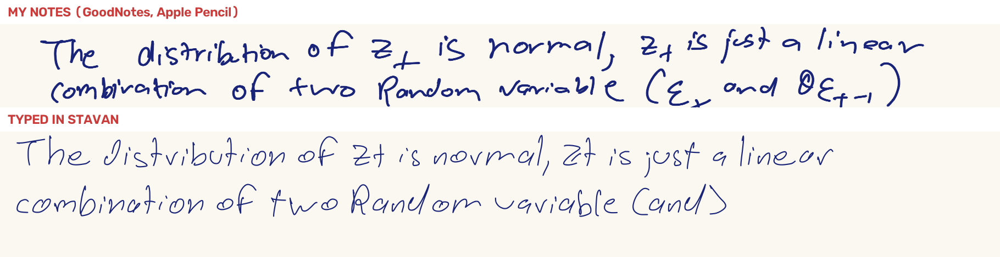

<p align="center">
  <a href="https://whiteknight07.github.io/stavan-font/"></a>
</p>

<p align="center">
  <b>A free handwriting font made from 675 pages of my real Apple Pencil notes.</b><br>
  Every letter has five versions from different pages, and they take turns as you type.
</p>

<p align="center">
  <a href="https://whiteknight07.github.io/stavan-font/"><b>Try it in your browser</b></a> &nbsp;|&nbsp;
  <a href="https://github.com/Whiteknight07/stavan-font/releases/latest"><b>Download</b></a> &nbsp;|&nbsp;
  <a href="#use-it-on-a-website">Use it on a website</a> &nbsp;|&nbsp;
  <a href="#animated-handwriting">Animated handwriting</a>
</p>

<p align="center">
  <a href="https://github.com/Whiteknight07/stavan-font/releases/latest"></a>
  <a href="OFL.txt"></a>
  <a href="LICENSE"></a>
  <a href="https://github.com/Whiteknight07/stavan-font/actions/workflows/ci.yml"></a>
</p>



Top: a line from my notes. Bottom: the same line typed in the font.

## What makes it different

- **Real strokes, not a template.** Most handwriting fonts come from writing the alphabet into boxes. This one was cut out of
  my everyday lecture notes, written fast and slow, so it keeps how I actually write. GoodNotes stores Apple Pencil ink as
  vector paths, so every letter is the exact path my pen took. Nothing was traced from photos or redrawn.
- **Five versions of every letter and digit.** They rotate as you type (OpenType `calt`), and the rotation carries across
  spaces, so the same word never comes out the same twice.
- **It can write itself.** Because the pen paths are kept in the order I drew them, the [playground](https://whiteknight07.github.io/stavan-font/)
  and the [JS library](#animated-handwriting) can replay any text stroke by stroke.
- **Full keyboard.** All of ASCII, accented letters (é, ü, ñ, ç…), curly quotes, dashes and ellipsis. 150 characters, 705 versions.

## Install it on your computer

Download `Stavan-Regular.ttf` and `Stavan-Bold.ttf` from the [latest release](https://github.com/Whiteknight07/stavan-font/releases/latest)
(or from [`dist/`](dist)), double-click each one and choose Install.

The letter rotation turns on by itself in Pages, Keynote, TextEdit, Figma, Photoshop, Illustrator, InDesign and every
browser. **In Microsoft Word**, turn on Format › Font › Advanced › "Use Contextual Alternates" once. Google Docs can't use
installed fonts, so use the web version there.

## Use it on a website

```html
<link rel="stylesheet" href="https://cdn.jsdelivr.net/gh/Whiteknight07/stavan-font@1/dist/stavan.css">

<p class="stavan">Hello in my handwriting</p>
```

Or use your own CSS: `font-family: "Stavan", cursive;`. The weights are 400 and 700.
To self-host, copy `dist/*.woff2` and `dist/stavan.css` into your project.

## Animated handwriting

Turn any text into an SVG that writes itself, using the real pen strokes in the order they were written.
The SVG plays in browsers, in `` tags and in GitHub READMEs, like the one at the top of this page.

**In the browser:** type on the [playground](https://whiteknight07.github.io/stavan-font/) and choose "Save animation".

**From JavaScript:**

```js
import { load } from "https://cdn.jsdelivr.net/gh/Whiteknight07/stavan-font@1/site/stavan.js";

const hand = await load("https://cdn.jsdelivr.net/gh/Whiteknight07/stavan-font@1/site/data/");
document.body.insertAdjacentHTML("beforeend", hand.svg("hello there", { size: 64, animate: true, color: "#007aff" }));
```

`hand.svg(text, options)` takes `size` (px per em), `color`, `maxWidth` (px, wraps at spaces), `animate`, `speed`
(x-heights per second, default 13) and `background`. `hand.draw(ctx, text, options)` draws onto a canvas instead.

**From the command line** (Node 18+):

```sh
node site/write.mjs "Hi, this is Stavan." --size 60 --color "#007aff" > hello.svg
node site/write.mjs "thick and still" --weight Bold --static > still.svg
```

## Turn the whole internet into my handwriting

The [playground](https://whiteknight07.github.io/stavan-font/#use-h) has a bookmarklet. Drag it to your bookmarks bar,
click it on any site, and every page switches to Stavan until you reload.

## How it was made

The pipeline lives in [`hand/`](hand). It takes GoodNotes PDF exports and ends with TTF and WOFF2 files.

| Step | Script | What it does |
| --- | --- | --- |
| 1 | `extract.py` | Pulls every Apple Pencil stroke out of the PDFs as exact pen paths (286,273 strokes from 675 pages) |
| 2 | `segment.py`, `make_sheets.py` | Groups strokes into words and letters, then draws numbered contact sheets |
| 3 | (subagents) | GPT 6.1 Sol read 6,240 words off the contact sheets |
| 4 | `harvest.py` | Matches each transcription to its strokes (DP alignment), fits baseline and x-height per word, re-attaches i/j dots |
| 5 | `retrieve.py` | Finds rare characters (crossed Z, J, Q, ?) by shape among unlabelled strokes, then has them verified in context |
| 6 | `select_variants.py`, `qa.py` | Ranks samples by how typical they are, reviews 16 candidates per character, keeps 5 varied approved ones |
| 7 | `design.py`, `construct.py` | Light-touch sizing that keeps each letter's own size and bounce; builds accents and missing symbols from my own strokes |
| 8 | `build_font.py` | Round GoodNotes-style pen, then potrace, then TrueType; adds the 5-slot rotation, kerning, WOFF/WOFF2 and the web data |
| 9 | `export_words.py` | Exports the source words for the playground's "where each letter came from" and "real or font?" |

Some characters never appear in the notes. These were built from pieces of my own strokes: `! ^ \ # % $ @ & { }` and the backtick,
`…`, curly quotes, dashes and the accents.

### Build it yourself

```sh
uv venv && uv pip install -r requirements.txt   # or: pip install -r requirements.txt
brew install potrace                             # or: apt install potrace
cd hand && ../.venv/bin/python build_font.py     # design/ -> dist/ fonts + site/data/
python golden.py && node ../test/layout.test.mjs # check the site's layout against HarfBuzz
```

The source notes (`data/`) and intermediate files (`work/`) are private and not in this repo, so steps 1 to 7 need your
own notes. `build_font.py` rebuilds the font from `design/` alone. To drop a bad version of a letter, add
`[char, word_id, group]` to `design/reject.json` (the ids are in `design/glyphs.json` under `src`), then rerun steps 6 to 8.

Want to make a font from your own notes? Fork this repo, export your GoodNotes notebooks as PDF into `data/`, and run
the steps in order.

## License

The font is free for personal and commercial use under the [SIL Open Font License 1.1](OFL.txt). You can use it,
embed it and bundle it, but not sell the font files on their own. The code is [MIT](LICENSE).

Inspired by [harshpreet931/harshpreet-hand](https://github.com/harshpreet931/harshpreet-hand) (MIT); `build_font.py` is adapted from it.
